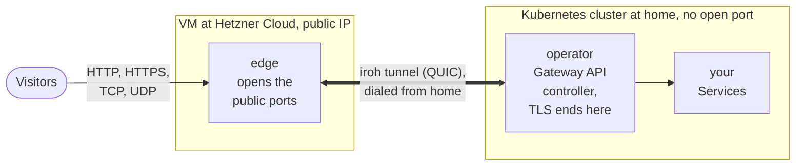

# iroh-gateway

Put the services of a private Kubernetes cluster on the internet through a small public VM. The cluster opens no port, and visitors only ever see the VM's address.



iroh-gateway has two parts:

- **The edge** (`iroh-gateway-edge`) is one static binary on a machine with a public address, for example a small VM at Hetzner Cloud. It opens the public ports and keeps nothing but its own key and the operator's id: no certificate, no routes, no credentials for the cluster.
- **The operator** (`iroh-gateway-operator`) runs in the cluster as a [Gateway API](https://gateway-api.sigs.k8s.io/) controller. It dials out to the edge over [iroh](https://www.iroh.computer/) (QUIC, each side pinned to the other's ed25519 key), tells it which ports to open, and routes what arrives to your Services; HAProxy in its own pod terminates TLS.

What that gives you:

- **Nothing points at your home.** DNS names resolve to the VM. The cluster only dials out, over UDP; the router forwards no port and needs no static address. Only the VM sees where the tunnel comes from (and a relay, if you turn [relay mode](#relay-mode) on).
- **TLS ends in the cluster.** Certificates and their keys stay in Kubernetes Secrets, and the VM carries HTTPS it cannot read.
- **Plain Gateway API.** `Gateway`, `HTTPRoute`, `TCPRoute` and `UDPRoute` objects of the class `iroh-gateway`; the [walkthrough](#walkthrough-from-an-empty-vps-to-an-https-site) adds cert-manager and external-dns.
- **HTTP, HTTPS, raw TCP and UDP**, with Prometheus metrics on both sides.
- **Several edges for failover.** A Gateway lists only the addresses of the edges that are connected, so DNS follows the tunnels (see [Several edges and failover](#several-edges-and-failover)).

## Install with Helm

You need a Kubernetes cluster with `kubectl` and Helm 3.8 or later, and a Linux VM with a public address. The cluster needs outbound UDP to the VM's port 7842 and no inbound port.

**1. In the cluster**, install the Gateway API v1.7.0 CRDs, then the chart:

```sh
kubectl apply --server-side -f https://github.com/kubernetes-sigs/gateway-api/releases/download/v1.7.0/standard-install.yaml

helm install iroh-gateway oci://ghcr.io/fables-for-robots/charts/iroh-gateway \
  --namespace iroh-gateway --create-namespace --wait --timeout 180s
```

This installs the newest released chart: the operator, the `Edge` CRD and a `GatewayClass` named `iroh-gateway`. Add `--version <X.Y.Z>` to pin a version from the [releases page](https://github.com/fables-for-robots/iroh-gateway/releases). [More about the chart](#more-about-the-chart) has its values, its RBAC rules and how to run what is on `main`.

**2. On the VM**, install the edge from the release's tarball (a static binary and a hardened systemd unit) and read its id. Steps [3](#3-the-edge-on-the-vps-and-its-id) to [5](#5-the-operators-id-and-the-edge-started) of the walkthrough have the commands; [The edge on a machine of its own](#the-edge-on-a-machine-of-its-own) also covers NixOS and a container.

**3. Connect the two.** A `Gateway` of the class `iroh-gateway` says which ports to open, and an `Edge` binds the edge to it by its id and address:

```yaml
apiVersion: gateway.networking.k8s.io/v1
kind: Gateway
metadata:
  name: public
  namespace: iroh-gateway
spec:
  gatewayClassName: iroh-gateway
  listeners:
    - name: http
      protocol: HTTP
      port: 80
---
apiVersion: gateway.fables-for-robots.ch/v1alpha1
kind: Edge
metadata:
  name: vps
  namespace: iroh-gateway
spec:
  endpointId: <the edge's id>
  address: 203.0.113.10:7842 # the VM's public address and the edge's iroh port
  gatewayRef:
    name: public
```

The edge is then started with the operator's id, which the `Edge`'s status shows. From there the edge serves only that operator, and the operator dials only the edges it lists.

**4. Route something.** A route attached to a listener makes the edge open that listener's port. This one sends `app.example.com` on port 80 to the Service `web`:

```yaml
apiVersion: gateway.networking.k8s.io/v1
kind: HTTPRoute
metadata:
  name: app
  namespace: iroh-gateway
spec:
  parentRefs:
    - name: public
      sectionName: http
  hostnames:
    - app.example.com
  rules:
    - backendRefs:
        - name: web
          port: 8080
```

The [walkthrough](#walkthrough-from-an-empty-vps-to-an-https-site) does all of this in nine steps, from an empty VM to `https://app.example.com/` with a Let's Encrypt certificate. [Kubernetes](#kubernetes) describes raw TCP, HTTPS and UDP.

Without a cluster, the [quickstart](#quickstart-without-a-cluster) runs both sides on one machine from a configuration file. The design is in [the spec](docs/superpowers/specs/2026-11-23-iroh-gateway-design.md).

## Contents

- [Install with Helm](#install-with-helm)
- [More about the chart](#more-about-the-chart)
- [The edge on a machine of its own](#the-edge-on-a-machine-of-its-own): systemd, NixOS, container
- [Walkthrough: from an empty VPS to an HTTPS site](#walkthrough-from-an-empty-vps-to-an-https-site)
- [Metrics and health](#metrics-and-health)
- [Kubernetes](#kubernetes): the objects, several edges and failover, raw TCP, HTTP and HTTPS, UDP, status conditions
- [Releases](#releases)
- [Upgrading from the manifests in `deploy/`](#upgrading-from-the-manifests-in-deploy)
- [Build](#build)
- [Quickstart without a cluster](#quickstart-without-a-cluster)
- [`iroh-gateway-edge`](#iroh-gateway-edge) and [`iroh-gateway-operator`](#iroh-gateway-operator): the flags
- [Running in production](#running-in-production)
- [Trust](#trust)
- [Relay mode](#relay-mode)
- [Known limitations](#known-limitations)

## More about the chart

### Prerequisites: the Gateway API CRDs

The Gateway API v1.7.0 standard CRDs, which include `HTTPRoute`, `TCPRoute` and `UDPRoute`:

```sh
kubectl apply --server-side -f https://github.com/kubernetes-sigs/gateway-api/releases/download/v1.7.0/standard-install.yaml
```

The `UDPRoute` CRD must be installed: the operator applies nothing until every kind it watches has been listed once. Install the CRDs before the chart, which creates a `GatewayClass`.

### The chart

The chart installs the `Edge` CRD, the RBAC rules, the `GatewayClass` named `iroh-gateway`, the operator with its probes, and a Service in front of its metrics port. With `--wait`, Helm returns once the operator's pod is ready (see [Readiness](#readiness)).

A released version, from the OCI registry (Helm 3.8 or later), with `<X.Y.Z>` a version from the [releases page](https://github.com/fables-for-robots/iroh-gateway/releases) without its `v`; without `--version`, Helm takes the newest:

```sh
helm install iroh-gateway oci://ghcr.io/fables-for-robots/charts/iroh-gateway --version <X.Y.Z> \
  --namespace iroh-gateway --create-namespace --wait --timeout 180s
```

The chart is pushed there only when a version is tagged. To run what is on `main` instead, install from a checkout, with the operator image built from `main`:

```sh
git clone https://github.com/fables-for-robots/iroh-gateway
cd iroh-gateway
helm install iroh-gateway charts/iroh-gateway --namespace iroh-gateway --create-namespace \
  --set image.tag=edge --set image.pullPolicy=Always --wait --timeout 180s
```

Without `image.tag`, the chart asks for the image tagged with its own `appVersion`, which in a checkout is the placeholder `0.0.0-dev` and does not exist. `edge` is moved to every new build of `main`, so `image.pullPolicy=Always` makes a restarted pod take the newest one. To use an image you built yourself, in a kind cluster named `kind`:

```sh
docker build --target operator -t iroh-gateway-operator:dev .
docker build --target edge -t iroh-gateway-edge:dev .
kind load docker-image iroh-gateway-operator:dev iroh-gateway-edge:dev
helm install iroh-gateway charts/iroh-gateway --namespace iroh-gateway --create-namespace \
  --set image.repository=iroh-gateway-operator --set image.tag=dev \
  --set image.pullPolicy=IfNotPresent --wait --timeout 180s
```

`scripts/e2e-kind.sh` installs the chart this way (with its own tag and `networkPolicy.enabled=true`). Helm installs the `Edge` CRD only on the first install and never upgrades it; the [chart's README](charts/iroh-gateway/README.md#crd-lifecycle) gives the command for a changed CRD. The chart creates no namespace; `--create-namespace` creates the release namespace.

The release name `iroh-gateway` gives the chart's objects the name `iroh-gateway`; the commands in this README assume it, and the namespace `iroh-gateway`.

### Values that matter

The chart's README lists [every value](charts/iroh-gateway/README.md#values). The ones most installations touch:

- `gatewayNamespaces`: the namespaces whose `Gateway` and `Edge` objects the operator serves; by default only the release namespace. Each listed namespace must exist before the install and gets a Role that lets the operator read its Secrets (see [Secrets](#secrets)). For example `--set 'gatewayNamespaces={iroh-gateway,apps}'`.
- `relay`: `disabled` (the default), `n0` or a relay URL; it must match the edges' `--relay` (see [Relay mode](#relay-mode)).
- `addressGrace` (default `30s`): how long a Gateway keeps listing the addresses of an edge whose connection has dropped (see [Several edges and failover](#several-edges-and-failover)).
- `metrics.port` (default 8080), where the operator serves `/metrics`, `/healthz` and `/readyz`; `metrics.service.enabled` (default `true`) puts a ClusterIP Service in front of it, and `metrics.serviceMonitor.enabled=true` adds a ServiceMonitor for the Prometheus Operator (see [Metrics and health](#metrics-and-health)). The port is bound on `metrics.bindAddress`, by default `0.0.0.0`, which is IPv4 only: on a cluster whose pod IPs are IPv6, pass `--set 'metrics.bindAddress=[::]'`, or the kubelet's probes cannot reach the operator and `helm install --wait` times out.
- `networkPolicy.enabled=true` adds a NetworkPolicy that admits ingress to the operator pod only on the metrics port, from the peers in `networkPolicy.metricsFrom` (any source when empty), and leaves egress open: the operator must be able to send UDP to the edges, and TCP and UDP to the backend Services.

### What the chart grants

A ClusterRole lets the operator `get`, `list` and `watch` `GatewayClass`, `Gateway`, `TCPRoute`, `UDPRoute`, `HTTPRoute`, `Edge`, `Service` and `Namespace` objects in every namespace, and `patch` the status of the Gateway API objects and the `Edge`s; it writes status only with `patch`. It holds no rule on Secrets.

The operator creates its own key in the Secret `iroh-gateway-identity` in `iroh-gateway` on first start: a Role there lets it `get` that Secret by name and `create` Secrets there (the chart's `identity.secretName` sets both the flag and the Role's `resourceNames`). For HTTPS it also lists and watches the Secrets of every namespace it serves Gateways in, which means it can read every Secret there; see [Secrets](#secrets). The container runs as user 65532 with a read-only root filesystem; HAProxy's files go to a private directory `haproxy` that the operator creates in the in-memory volume at `/run/iroh-gateway`. `rbac.create=false` leaves all of this out, and you grant the same rules yourself.

## The edge on a machine of its own

The edge needs a machine with a public address, its iroh UDP port (7842 by default) reachable from the operator, and the ports of the Gateway reachable from visitors. It keeps nothing but its key. There are three ways to run it.

### From the release tarball, with systemd

A release attaches, for each of `x86_64-unknown-linux-musl` and `aarch64-unknown-linux-musl`, a tarball `iroh-gateway-edge-<tag>-<target>.tar.gz`, and a file `SHA256SUMS` with their checksums. A tarball holds four files at its top level, which go:

| File | Goes to |
|---|---|
| `iroh-gateway-edge`, the edge, a static binary | `/usr/local/bin/iroh-gateway-edge` |
| `iroh-gateway-edge.service`, its systemd unit | `/etc/systemd/system/iroh-gateway-edge.service` |
| `README.md`, `LICENSE` | nowhere in particular |

The unit runs the edge as a dynamic user with `CAP_NET_BIND_SERVICE` as its only capability (so it can open ports below 1024), keeps the key in its state directory `/var/lib/iroh-gateway-edge`, reads its settings from `/etc/iroh-gateway-edge/env`, raises the open-file limit to 65536 and restarts the edge 2 s after it exits. The env file holds `IROH_GATEWAY_EDGE_*` variables, one per flag of `iroh-gateway-edge run` (see [`iroh-gateway-edge`](#iroh-gateway-edge)); `IROH_GATEWAY_EDGE_OPERATOR` is required. Steps 3 and 5 of the walkthrough install it.

To build the binary yourself instead, use the release workflow's commands, on a Linux machine of the target's architecture with [rustup](https://rustup.rs) (the repository's `rust-toolchain.toml` selects Rust 1.100.0, and rustup adds the components it lists on first use) and Debian's or Ubuntu's `musl-tools`; for aarch64 use `aarch64-unknown-linux-musl`:

```sh
git clone https://github.com/fables-for-robots/iroh-gateway
cd iroh-gateway
sudo apt-get install -y musl-tools
rustup toolchain install 1.100.0 --target x86_64-unknown-linux-musl
TARGET_CC=musl-gcc cargo build --release --locked -p iroh-gateway-edge --target x86_64-unknown-linux-musl
```

The binary is then `target/x86_64-unknown-linux-musl/release/iroh-gateway-edge`, and the unit is `dist/iroh-gateway-edge.service`; copy both to the VPS and use them as the tarball's files. On a GitHub x86_64 runner, the release workflow checks that the binary is static, that `systemd-analyze verify` accepts the unit, and that the unit, installed and started as in the walkthrough, binds UDP 7842 and logs the id that `systemd-run` printed. It checks nothing with an operator connected.

To update the edge, replace the binary and run `systemctl restart iroh-gateway-edge`; the key stays.

### With NixOS

The flake has a NixOS module, `nixosModules.edge`, that runs the edge as the service `iroh-gateway-edge` with the same hardening as the unit, and packages `packages.<system>.edge` and `packages.<system>.operator` for `x86_64-linux`, `aarch64-linux` and `aarch64-darwin`. In a flake-based system configuration:

```nix
# flake.nix
{
  inputs = {
    nixpkgs.url = "github:NixOS/nixpkgs/nixos-26.05";
    iroh-gateway.url = "github:fables-for-robots/iroh-gateway";
  };
  outputs = { nixpkgs, iroh-gateway, ... }: {
    nixosConfigurations.edge = nixpkgs.lib.nixosSystem {
      system = "x86_64-linux";
      modules = [
        iroh-gateway.nixosModules.edge
        ./configuration.nix
      ];
    };
  };
}
```

```nix
# configuration.nix, the part about the edge
{ ... }:
{
  services.iroh-gateway-edge = {
    enable = true;
    # The operator's EndpointId (step 5 of the walkthrough): 64 lowercase hex characters.
    operator = "<operator id>";
    # Opens the UDP port of irohListen (7842) in the NixOS firewall, and only that port.
    openFirewall = true;
    # Prometheus metrics on the machine itself; null (the default) serves none.
    metricsListen = "127.0.0.1:9090";
  };
  # The Gateway's ports, which the module leaves to you.
  networking.firewall.allowedTCPPorts = [ 80 443 ];
}
```

The other options are `package`, `keyFile` (default `/var/lib/iroh-gateway-edge/edge.key`), `irohListen` (`0.0.0.0:7842`), `publicBind` (`::`), `maxConnections` (2048), `maxUdpFlows` (4096), `udpRateLimit` (`null`, no limit), `tunnelGrace` (`"5s"`), `relay` (`"disabled"`) and `extraArgs` (`[]`, appended to `iroh-gateway-edge run`); they set the flags of the same names. The module refuses an `operator` that is not 64 lowercase hex characters, so the edge's id has to be read before the module is enabled. This prints it and creates the key in the service's state directory, the same way as on any other systemd machine (it needs the `nix` command with flakes enabled):

```sh
sudo systemd-run --wait --pipe --collect -p DynamicUser=yes -p StateDirectory=iroh-gateway-edge \
  "$(nix build --no-link --print-out-paths github:fables-for-robots/iroh-gateway#edge)/bin/iroh-gateway-edge" id
```

A NixOS VM test (`nix build .#checks.x86_64-linux.edge-module`, on x86_64 Linux with KVM) checks that the module starts the edge as a dynamic user with its key in the state directory, that it binds UDP 7842 and the firewall lets it in, that metrics are served, and that a restart keeps the id. The `systemd-run` command above is not part of it, and nothing tests the module with an operator connected. `aarch64-linux` is neither built nor evaluated by CI.

The operator package runs HAProxy as a child process; its wrapper puts nixpkgs' `haproxy` first on `PATH`, so only `--haproxy-bin` or `IROH_GATEWAY_HAPROXY_BIN` choose another one.

### As a container

The image `ghcr.io/fables-for-robots/iroh-gateway-edge` (tags as for the operator: `edge` and `sha-<commit>` from `main`; `<X.Y.Z>` and `latest` for a release) is a distroless image whose entrypoint is the edge binary; it runs as user 65532. Create the key and read the id with it:

```sh
mkdir keys
docker run --rm -v "$PWD/keys:/keys" --user "$(id -u)" ghcr.io/fables-for-robots/iroh-gateway-edge:edge \
  id --key-file /keys/edge.key
```

`scripts/e2e-kind.sh` runs the edge this way as a pod in the cluster, next to the operator, which is a way to try everything in one test cluster. The key goes into a Secret, `kubectl -n iroh-gateway create secret generic edge-key --from-file=edge.key=keys/edge.key`, and the edge is a Deployment with a Service that lists the iroh port and every port of the Gateway:

```yaml
apiVersion: apps/v1
kind: Deployment
metadata:
  name: edge
  namespace: iroh-gateway
spec:
  replicas: 1
  selector:
    matchLabels:
      app: edge
  template:
    metadata:
      labels:
        app: edge
    spec:
      containers:
        - name: edge
          image: ghcr.io/fables-for-robots/iroh-gateway-edge:edge
          args:
            - run
            - --key-file=/keys/edge.key
            - --operator=<operator id>
            - --iroh-listen=0.0.0.0:7842
            - --public-bind=0.0.0.0
            - --metrics-listen=0.0.0.0:9090
          volumeMounts:
            - name: key
              mountPath: /keys
              readOnly: true
      volumes:
        - name: key
          secret:
            secretName: edge-key
---
apiVersion: v1
kind: Service
metadata:
  name: edge
  namespace: iroh-gateway
spec:
  selector:
    app: edge
  ports:
    - name: iroh
      protocol: UDP
      port: 7842
    - name: public
      protocol: TCP
      port: 8080
    - name: metrics
      protocol: TCP
      port: 9090
```

The Service lists the public port 8080, which fits the Gateway of the [raw TCP example](#raw-tcp); for another Gateway, list that Gateway's ports instead. Its `Edge` then has `address: edge.iroh-gateway.svc:7842`. Visitors inside the cluster reach the Gateway's ports at the Service; nothing reaches it from outside. Running the image on a VPS instead needs the iroh port and every port of the Gateway published (or host networking), a writable volume for the key, and, for ports below 1024, a way to bind them as a non-root user; none of that is tested.

## Walkthrough: from an empty VPS to an HTTPS site

This puts `https://app.example.com/` online: a cluster that is not reachable from the internet runs the operator and the site, and a VPS with the public address `203.0.113.10` runs the edge. Replace `example.com`, `app.example.com` and `203.0.113.10` with your own; the operator and the Gateway are in the namespace `iroh-gateway`.

What a test runs and what none does: `scripts/e2e-kind.sh`, in CI, installs the Gateway API CRDs and the chart from the checkout into a kind cluster, enrols an edge that runs as a pod in that cluster (the same exchange of ids as steps 3 to 5, but no VPS), sends TCP, HTTP, HTTPS and UDP through it, installs cert-manager v1.21.3 as in step 8, has a self-signed `ClusterIssuer` issue a certificate for an annotated Gateway and checks that the HTTPS listener serves it, and checks that `cert-manager.io/ignore-tls-listeners` keeps cert-manager off another listener's Secret. A model test (`the_acme_http01_solver_route_is_served`) checks that the operator serves an `HTTPRoute` of the shape cert-manager's HTTP-01 solver creates. No test runs Let's Encrypt, external-dns, or the VPS itself: an edge on a separate machine connected to an operator, and the path from the internet through it. This text was written on 2026-11-25 against Gateway API v1.7.0, cert-manager v1.21.3 and external-dns v0.24.0. cert-manager v1.21.3 is built against Gateway API v1.6.0; its documentation says cert-manager 1.14 and later is tested with the v1 Gateway API, and it uses only the `v1` `Gateway` and `HTTPRoute`, which v1.7.0's standard channel serves.

What you need:

- A Kubernetes cluster, `kubectl` and `helm` (3.8 or later) pointed at it. The cluster needs outbound UDP to the VPS's port 7842, and outbound TCP to the VPS's port 80 for cert-manager's check in step 8; it needs no inbound port.
- A Linux VPS with systemd, x86_64 or aarch64, with the public address `203.0.113.10`, and root on it.
- A domain whose DNS you control.

### 1. The Gateway API CRDs

```sh
kubectl apply --server-side -f https://github.com/kubernetes-sigs/gateway-api/releases/download/v1.7.0/standard-install.yaml
```

### 2. The chart

With `<X.Y.Z>` a version from the [releases page](https://github.com/fables-for-robots/iroh-gateway/releases), without its `v`:

```sh
helm install iroh-gateway oci://ghcr.io/fables-for-robots/charts/iroh-gateway --version <X.Y.Z> \
  --namespace iroh-gateway --create-namespace --wait --timeout 180s
```

To run what is on `main` instead, install from a checkout as under [The chart](#the-chart). `helm install` returns once the operator is ready; `kubectl -n iroh-gateway get pods` shows it `Running` and `1/1` ready. If the pod stays in `ImagePullBackOff`, the image cannot be pulled (see [Known limitations](#known-limitations)).

### 3. The edge on the VPS, and its id

On the VPS, as root. Download the tarball of a release and check it (with `aarch64-unknown-linux-musl` on an ARM machine):

```sh
VERSION=<vX.Y.Z>
TARGET=x86_64-unknown-linux-musl
curl -fLO "https://github.com/fables-for-robots/iroh-gateway/releases/download/$VERSION/iroh-gateway-edge-$VERSION-$TARGET.tar.gz"
curl -fLO "https://github.com/fables-for-robots/iroh-gateway/releases/download/$VERSION/SHA256SUMS"
sha256sum --check --ignore-missing SHA256SUMS
mkdir edge && tar -xzf "iroh-gateway-edge-$VERSION-$TARGET.tar.gz" -C edge && cd edge
```

Install the binary and the unit, and create the directory of the env file:

```sh
install -m 0755 iroh-gateway-edge /usr/local/bin/iroh-gateway-edge
install -m 0644 iroh-gateway-edge.service /etc/systemd/system/iroh-gateway-edge.service
install -d -m 0755 /etc/iroh-gateway-edge
systemctl daemon-reload
```

Print the edge's id. This runs `iroh-gateway-edge id` as the service would run, so the key it creates lands in the service's state directory, `/var/lib/iroh-gateway-edge`:

```sh
systemd-run --wait --pipe --collect -p DynamicUser=yes -p StateDirectory=iroh-gateway-edge /usr/local/bin/iroh-gateway-edge id
```

It prints 64 hex characters, the edge's EndpointId; running it again prints the same. Back up the key: it is the edge's identity. The key is in `/var/lib/private/iroh-gateway-edge/edge.key` (systemd keeps a dynamic user's state directory there and links `/var/lib/iroh-gateway-edge` to it).

Open the VPS's firewall, in the provider's settings and on the machine if it runs one, for TCP 80 and 443 from visitors and UDP 7842 from the operator. With `ufw`, for example:

```sh
ufw allow 80/tcp
ufw allow 443/tcp
ufw allow 7842/udp
```

On NixOS, read the id with the command under [With NixOS](#with-nixos) and leave the firewall to the module's `openFirewall` and `networking.firewall.allowedTCPPorts`.

### 4. The `Edge` and the `Gateway`

On the machine with `kubectl`. The `Edge` names the edge's id and the address where the operator dials it; the `Gateway` has an `HTTP` listener on port 80, which cert-manager's challenge needs, and an `HTTPS` listener on port 443 for `app.example.com` with the certificate cert-manager will write into the Secret `app-tls`:

```yaml
apiVersion: gateway.networking.k8s.io/v1
kind: Gateway
metadata:
  name: public
  namespace: iroh-gateway
spec:
  gatewayClassName: iroh-gateway
  listeners:
    - name: http
      protocol: HTTP
      port: 80
    - name: https
      protocol: HTTPS
      port: 443
      hostname: app.example.com
      tls:
        mode: Terminate
        certificateRefs:
          - name: app-tls
---
apiVersion: gateway.fables-for-robots.ch/v1alpha1
kind: Edge
metadata:
  name: vps
  namespace: iroh-gateway
spec:
  endpointId: <edge id from step 3>
  address: 203.0.113.10:7842
  gatewayRef:
    name: public
```

Save it as `gateway.yaml` and apply it with `kubectl apply -f gateway.yaml`. Until the Secret `app-tls` exists, the `https` listener shows `ResolvedRefs` `False` with `InvalidCertificateRef` and serves nothing, and the Gateway is `Accepted` `True` with reason `ListenersNotValid`; the `http` listener is not affected.

The Gateway's address comes from the `Edge`, once its edge is connected: after step 5, `kubectl -n iroh-gateway get gateway public` shows `203.0.113.10` under `ADDRESS`; until then it shows none. The operator lists in `Gateway.status.addresses` the `spec.publicAddresses` of every connected `Edge` bound to the Gateway, or, for an `Edge` without them, the host of its `address`; an IP address as type `IPAddress`, a DNS name as `Hostname`. The address of an edge that stays disconnected for longer than the address grace (30 s by default) is withdrawn, the last one too (see [Several edges and failover](#several-edges-and-failover)). Set `publicAddresses` when visitors use other addresses than the one the operator dials, for example to add the VPS's IPv6 address: `publicAddresses: [203.0.113.10, "2001:db8::10"]`.

### 5. The operator's id, and the edge started

Read the operator's id from the `Edge`; it is filled in as soon as the operator has seen the `Edge`:

```sh
kubectl -n iroh-gateway get edge vps -o jsonpath='{.status.gatewayEndpointId}'
```

On the VPS, as root, write it into the env file and start the edge:

```sh
cat > /etc/iroh-gateway-edge/env <<'EOF'
IROH_GATEWAY_EDGE_OPERATOR=<operator id>
IROH_GATEWAY_EDGE_METRICS_LISTEN=127.0.0.1:9090
EOF
systemctl enable --now iroh-gateway-edge
```

The second line is optional: it serves the edge's metrics on the VPS itself (see [Metrics and health](#metrics-and-health)). `journalctl -u iroh-gateway-edge` shows `edge started` with the id from step 3, and `session started` once the operator has connected. In the cluster:

```sh
kubectl -n iroh-gateway wait --for=condition=Connected edges.gateway.fables-for-robots.ch/vps --timeout=120s
```

The edge now serves only that operator. No port is open for visitors yet: a port opens once a route is attached to its listener.

On NixOS, put the operator's id into `services.iroh-gateway-edge.operator` and switch to the configuration instead.

### 6. A backend and an `HTTPRoute`

A small web server stands in for the site; replace it with your own Service in the namespace `iroh-gateway` (a backend must be in the route's namespace). The route `app` sends requests for `app.example.com` on both listeners to it:

```yaml
apiVersion: apps/v1
kind: Deployment
metadata:
  name: web
  namespace: iroh-gateway
spec:
  replicas: 1
  selector:
    matchLabels:
      app: web
  template:
    metadata:
      labels:
        app: web
    spec:
      containers:
        - name: web
          image: busybox:1.37
          command:
            - sh
            - -c
            - "mkdir -p /www && echo 'hello from web' >/www/index.html && exec httpd -f -p 8080 -h /www"
          ports:
            - containerPort: 8080
---
apiVersion: v1
kind: Service
metadata:
  name: web
  namespace: iroh-gateway
spec:
  selector:
    app: web
  ports:
    - port: 8080
---
apiVersion: gateway.networking.k8s.io/v1
kind: HTTPRoute
metadata:
  name: app
  namespace: iroh-gateway
spec:
  parentRefs:
    - name: public
      sectionName: http
    - name: public
      sectionName: https
  hostnames:
    - app.example.com
  rules:
    - backendRefs:
        - name: web
          port: 8080
```

Apply it like the Gateway. The edge opens port 80 once the route is attached; the `http` listener is then `Programmed` `True`, which this prints:

```sh
kubectl -n iroh-gateway get gateway public \
  -o jsonpath='{.status.listeners[?(@.name=="http")].conditions[?(@.type=="Programmed")].status}'
```

Before any DNS record exists, ask the edge directly:

```sh
curl --resolve app.example.com:80:203.0.113.10 http://app.example.com/
```

It prints `hello from web`. Port 443 opens in step 8, once the certificate exists.

### 7. DNS

`app.example.com` must resolve to `203.0.113.10` before step 8: Let's Encrypt connects to it, and cert-manager checks the challenge through it first. Either create an `A` record for `app.example.com` with the value `203.0.113.10` at your DNS provider, or let external-dns create it from the cluster's objects.

external-dns v0.24.0 (`registry.k8s.io/external-dns/external-dns:v0.24.0`) reads `HTTPRoute`s with `--source=gateway-httproute`. For each route it publishes the route's `spec.hostnames`, each of which must match a listener's `hostname` (a listener without one matches any), and it takes the targets from every entry of the Gateway's `status.addresses`, unless the Gateway carries the annotation `external-dns.kubernetes.io/target`, which then wins. Here that is `203.0.113.10`, from the `Edge` (see step 4). According to its source, it considers a route only when the route's `status.parents` has an entry for the Gateway with `Accepted` `True`, and it does not look at the Gateway's `Programmed` condition. `--policy` is required since v0.22.0 and has no default: `upsert-only` never deletes records, `sync` also deletes them. Annotations are read with the prefix `external-dns.kubernetes.io/` since v0.22.0; the older `external-dns.alpha.kubernetes.io/` is read only with `--annotation-prefix=external-dns.alpha.kubernetes.io/` or `--enable-legacy-annotation-prefix`.

A deployment with the RBAC rules external-dns's documentation lists for its Gateway API sources. Fill in your provider and its credentials as external-dns's tutorial for that provider says, and an owner id of your own:

```yaml
apiVersion: v1
kind: Namespace
metadata:
  name: external-dns
---
apiVersion: v1
kind: ServiceAccount
metadata:
  name: external-dns
  namespace: external-dns
---
apiVersion: rbac.authorization.k8s.io/v1
kind: ClusterRole
metadata:
  name: external-dns
rules:
  - apiGroups: [""]
    resources: ["namespaces"]
    verbs: ["get", "watch", "list"]
  - apiGroups: ["gateway.networking.k8s.io"]
    resources: ["gateways", "httproutes", "grpcroutes", "tlsroutes", "tcproutes", "udproutes", "listenersets"]
    verbs: ["get", "watch", "list"]
---
apiVersion: rbac.authorization.k8s.io/v1
kind: ClusterRoleBinding
metadata:
  name: external-dns
roleRef:
  apiGroup: rbac.authorization.k8s.io
  kind: ClusterRole
  name: external-dns
subjects:
  - kind: ServiceAccount
    name: external-dns
    namespace: external-dns
---
apiVersion: apps/v1
kind: Deployment
metadata:
  name: external-dns
  namespace: external-dns
spec:
  replicas: 1
  strategy:
    type: Recreate
  selector:
    matchLabels:
      app: external-dns
  template:
    metadata:
      labels:
        app: external-dns
    spec:
      serviceAccountName: external-dns
      containers:
        - name: external-dns
          image: registry.k8s.io/external-dns/external-dns:v0.24.0
          args:
            - --source=gateway-httproute
            - --policy=upsert-only
            - --gateway-namespace=iroh-gateway
            - --domain-filter=example.com
            - --provider=<your provider>
            - --registry=txt
            - --txt-owner-id=<an id of yours>
          # The provider's credentials, as its tutorial says (env or a mounted Secret).
```

`--gateway-namespace` limits it to the Gateways in `iroh-gateway`; `--gateway-name` and `--gateway-label-filter` narrow it further, and `--namespace` and `--label-filter` narrow the routes. external-dns also has a Helm chart, version 1.24.0 for v0.24.0 (`oci://registry.k8s.io/external-dns/charts/external-dns`); its value `policy` is required, and `sources` defaults to `["service","ingress"]`, so it must be set to `["gateway-httproute"]`.

For `TCPRoute`s and `UDPRoute`s, which have no hostnames, external-dns takes the name from the annotation `external-dns.kubernetes.io/hostname` on the route (`--source=gateway-tcproute`, `--source=gateway-udproute`). v0.24.0 reads `UDPRoute` as `v1alpha2`, which the standard channel of Gateway API v1.7.0 does not serve (it serves `v1` only; the experimental channel still serves `v1alpha2`), so `--source=gateway-udproute` with v0.24.0 needs the experimental channel's `UDPRoute` CRD. Whether v0.24.0 then fails or only logs was not tried. It reads `TCPRoute` as `v1`, which needs Gateway API v1.6.0 or later.

Check the record with `dig +short app.example.com`, which prints `203.0.113.10` once it has spread.

### 8. A certificate from Let's Encrypt with cert-manager

Install cert-manager v1.21.3 with its Gateway API support, which is off by default. The Gateway API CRDs must be installed before cert-manager starts, as they are here; installed afterwards, they need a restart of cert-manager (`kubectl rollout restart deployment cert-manager -n cert-manager`):

```sh
helm install cert-manager oci://quay.io/jetstack/charts/cert-manager \
  --version v1.21.3 --namespace cert-manager --create-namespace \
  --set crds.enabled=true --set config.gatewayAPI.enabled=true --wait --timeout 300s
```

A `ClusterIssuer` for Let's Encrypt that answers the HTTP-01 challenge through the Gateway itself (cert-manager's `gatewayHTTPRoute` solver; since cert-manager 1.20 its `parentRefs` may be left out, and the annotated Gateway is used). Put your address in `email`:

```yaml
apiVersion: cert-manager.io/v1
kind: ClusterIssuer
metadata:
  name: letsencrypt
spec:
  acme:
    server: https://acme-v02.api.letsencrypt.org/directory
    email: you@example.com
    privateKeySecretRef:
      name: letsencrypt-account-key
    solvers:
      - http01:
          gatewayHTTPRoute: {}
```

Apply it (the webhook may refuse it for a minute after the install; apply again), then annotate the Gateway:

```sh
kubectl -n iroh-gateway annotate gateway public cert-manager.io/cluster-issuer=letsencrypt
```

To rehearse without Let's Encrypt's production rate limits, make a second `ClusterIssuer` with the staging server `https://acme-staging-v02.api.letsencrypt.org/directory` and its own `privateKeySecretRef`, and annotate the Gateway with that one first; its certificates are not trusted by browsers.

What cert-manager then does, from its documentation unless a point says otherwise (the parts this repository tests are named at the head of the walkthrough):

- For each listener of the annotated Gateway with protocol `HTTPS` or `TLS`, a `hostname`, `tls.mode: Terminate` and a Secret in `tls.certificateRefs`, it creates a `Certificate` named after the Secret, in the Gateway's namespace, for the listener's `hostname`: here the `Certificate` `app-tls` for `app.example.com`. It does not edit the Gateway.
- For the challenge it creates a temporary `HTTPRoute` named `cm-acme-http-solver-…` in the `Certificate`'s namespace, attached to the Gateway (according to cert-manager's source, without a `sectionName` or `port`, so to both listeners), for the hostname `app.example.com`, with one rule for the `Exact` path `/.well-known/acme-challenge/<token>` and a solver Service on port 8089 as its backend. On port 80 the operator tries an `Exact` path before the route `app`'s rule for every path, so the challenge reaches the solver.
- Before it asks Let's Encrypt, cert-manager fetches the challenge URL itself from inside the cluster, through DNS and the edge. Then Let's Encrypt fetches it, through the edge.
- Once the certificate is issued, cert-manager deletes the temporary route and writes the Secret `app-tls` of type `kubernetes.io/tls`. The operator checks the certificate, the `https` listener becomes usable, and the edge opens port 443. cert-manager renews the certificate before it expires (its general behaviour, not part of what was checked for this text), and the operator loads a renewed Secret as it loads any changed one (the kind test checks that with a Secret it replaces itself).

Watch it with `kubectl -n iroh-gateway get certificates.cert-manager.io,challenges.acme.cert-manager.io,httproutes`, and wait for it:

```sh
kubectl -n iroh-gateway wait --for=condition=Ready certificates.cert-manager.io/app-tls --timeout=300s
curl https://app.example.com/
```

`curl` prints `hello from web`. A challenge that does not pass shows why in `kubectl -n iroh-gateway describe challenges.acme.cert-manager.io`.

cert-manager takes every qualifying listener of an annotated Gateway and owns and overwrites its Secret. If the Gateway has HTTPS listeners whose Secrets you manage yourself, name them in the annotation `cert-manager.io/ignore-tls-listeners` (a comma-separated list of listener names, new in cert-manager 1.21), for example `kubectl -n iroh-gateway annotate gateway public cert-manager.io/ignore-tls-listeners=mine`.

When port 80 cannot be used, or for a wildcard name, use the DNS-01 challenge instead: cert-manager then proves control of the domain with a TXT record that it writes through your DNS provider's API, and the Gateway needs no `HTTP` listener for it. The solvers and their credentials are described in [cert-manager's DNS-01 documentation](https://cert-manager.io/docs/configuration/acme/dns01/).

### 9. HTTP redirected to HTTPS

With the certificate in place, send HTTP visitors to HTTPS. The route `app` keeps only the `https` listener, and a second route answers every HTTP request for `app.example.com` with a redirect to the same path and query over HTTPS:

```yaml
apiVersion: gateway.networking.k8s.io/v1
kind: HTTPRoute
metadata:
  name: app
  namespace: iroh-gateway
spec:
  parentRefs:
    - name: public
      sectionName: https
  hostnames:
    - app.example.com
  rules:
    - backendRefs:
        - name: web
          port: 8080
---
apiVersion: gateway.networking.k8s.io/v1
kind: HTTPRoute
metadata:
  name: app-redirect
  namespace: iroh-gateway
spec:
  parentRefs:
    - name: public
      sectionName: http
  hostnames:
    - app.example.com
  rules:
    - filters:
        - type: RequestRedirect
          requestRedirect:
            scheme: https
            statusCode: 301
```

`curl -I 'http://app.example.com/a?b=c'` then answers 301 with `Location: https://app.example.com/a?b=c`. The redirect's rule matches every path, so the `Exact` path of a renewal's challenge route still comes first on port 80, as in step 8; this combination is not covered by a test.

## Metrics and health

### Endpoints

Both binaries serve Prometheus metrics only when `--metrics-listen <addr>` is given (`IROH_GATEWAY_EDGE_METRICS_LISTEN` on the edge, `IROH_GATEWAY_METRICS_LISTEN` on the operator); without it nothing listens. An address that cannot be bound ends the process at start with an error that names it. The flag exists on `iroh-gateway-edge run` and on `iroh-gateway-operator run` and `static`. The chart always sets it, to `<metrics.bindAddress>:<metrics.port>` (`0.0.0.0:8080` by default). The operator's endpoint has no authentication, and as the chart installs it any pod in the cluster can reach it, unless `networkPolicy.enabled=true` with `networkPolicy.metricsFrom` set.

Three paths:

- `/metrics`, on both, in the Prometheus text format 0.0.4. On the operator in `run` mode it is the operator's own metrics followed by the output of HAProxy's Prometheus exporter (its `haproxy_*` metrics), which the operator fetches over a unix socket in its runtime directory within 2 s; if HAProxy does not answer, the operator's own metrics are served alone and `iroh_gateway_operator_haproxy_exporter_up` is 0.
- `/healthz`, on the operator: 200 `ok` while the process serves, from before it has reached the cluster. The chart's liveness probe uses it.
- `/readyz`, on the operator: see below. The chart's readiness probe uses it.

The edge serves only `/metrics`. Every other path is 404.

### Readiness

`/readyz` answers 503 `not ready` until the operator has applied its first pass over the cluster's objects, and 200 `ready` from then on, whatever HAProxy said to that configuration; it does not go back to 503. The first pass runs only once every watched kind has been listed, so an operator that cannot list what it watches (a missing CRD, a namespace without the Secret rules) is never ready, and `helm install --wait` times out. In `static` mode `/readyz` answers 200 once every link to an edge is started.

### Metrics of the edge

Every name starts with `iroh_gateway_edge_`. `direction` is `in` for traffic from visitors towards the backends and `out` for the way back. Every series exists from the start.

| Name | Type | Labels | What it counts |
|---|---|---|---|
| `build_info` | gauge | `version` | Always 1; `version` is the edge's version. |
| `session_up` | gauge | | 1 from a session's first applied configuration until that session ends. |
| `sessions_total` | counter | | Sessions with the operator installed. |
| `listeners` | gauge | `protocol` (`tcp`, `udp`) | Public ports open now. |
| `bind_failures_total` | counter | `protocol` (`tcp`, `udp`) | Binds of a public port the operating system refused. |
| `connections_open` | gauge | | TCP visitors holding a slot of `--max-connections`. |
| `connections_total` | counter | | TCP visitors accepted into a slot. |
| `connections_refused_total` | counter | `reason` (`cap`, `no_session`, `queue_full`) | TCP visitors dropped before a tunnel stream: the cap was reached; there was no session, the session had no configuration yet, or the visitor's listener had closed since; the queue from the ports to the edge's supervisor was full. |
| `tcp_bytes_total` | counter | `direction` | Bytes written to the tunnel stream (`in`) and to the visitor (`out`). |
| `udp_flows` | gauge | | UDP flows held. |
| `udp_flows_total` | counter | | UDP flows created. |
| `udp_flows_evicted_total` | counter | | UDP flows pushed out at the flow cap. |
| `udp_packets_total` | counter | `direction` | UDP packets handed to the tunnel in full (`in`) and sent to a visitor (`out`). |
| `udp_bytes_total` | counter | `direction` | Payload bytes of the packets in `udp_packets_total`. |
| `udp_fragmented_packets_total` | counter | `direction` | UDP packets split into more than one datagram (`in`) or reassembled from more than one (`out`). |
| `udp_dropped_total` | counter | `reason` (`no_session`, `rate_limit`, `send_error`, `tunnel_full`, `unknown_flow`, `bad_datagram`) | Dropped UDP packets or datagrams: no session; over `--udp-rate-limit`; the packet could not be sent (no datagram fits the path, it needs more than 64 pieces, the connection refused it, or a reply's port queue was full or gone); [the tunnel was full](#the-full-tunnel-rule); a reply for a flow the edge no longer holds; a datagram from the operator that cannot be read. |

### Metrics of the operator

Every name starts with `iroh_gateway_operator_`. Every `tunnel_*` metric has the label `edge`, the edge's EndpointId as 64 hex characters; a link to an edge sets up all of its series at 0 when it starts and removes them when it ends (its `Edge` is deleted or no longer accepted, or its id or address changes). `direction` is as on the edge. In `static` mode the HAProxy and controller series exist and stay at 0, `haproxy_config_ok` included.

| Name | Type | Labels | What it counts |
|---|---|---|---|
| `build_info` | gauge | `version` | Always 1; `version` is the operator's version. |
| `tunnel_up` | gauge | `edge` | 1 while the edge is connected. |
| `tunnel_path` | gauge | `edge`, `path` | 1 for the path the tunnel sends on, `direct` or `relay`, 0 for the other; both 0 while not connected. |
| `tunnel_path_selected_total` | counter | `edge`, `path` | Times a connection to the edge selected a `direct` or a `relay` path to send on, its first path included. |
| `tunnel_sessions_total` | counter | `edge` | Dials of the edge that connected. |
| `tunnel_dial_failures_total` | counter | `edge` | Dials of the edge that failed. |
| `tunnel_listeners` | gauge | `edge`, `state` (`bound`, `failed`) | The edge's listeners, bound or failed, from its last status; both 0 while it is not connected. |
| `tunnel_streams_open` | gauge | `edge` | Visitor streams being served. |
| `tunnel_streams_total` | counter | `edge` | Visitor streams accepted. |
| `tunnel_streams_refused_total` | counter | `edge`, `reason` (`bad_header`, `unknown_listener`, `backend_unavailable`) | Visitor streams reset before forwarding. |
| `tunnel_tcp_bytes_total` | counter | `edge`, `direction` | Bytes written to the backend (`in`) and to the tunnel stream (`out`). |
| `tunnel_udp_flows` | gauge | `edge` | UDP flows held; 0 after a session. |
| `tunnel_udp_flows_total` | counter | `edge` | UDP flows created. |
| `tunnel_udp_flows_evicted_total` | counter | `edge` | UDP flows pushed out at the flow cap. |
| `tunnel_udp_packets_total` | counter | `edge`, `direction` | UDP packets sent to a backend (`in`) and replies handed to the tunnel in full (`out`). |
| `tunnel_udp_bytes_total` | counter | `edge`, `direction` | Payload bytes of the packets in `tunnel_udp_packets_total`. |
| `tunnel_udp_fragmented_packets_total` | counter | `edge`, `direction` | UDP packets reassembled from more than one datagram (`in`) and replies split into more than one (`out`). |
| `tunnel_udp_dropped_total` | counter | `edge`, `reason` (`bad_datagram`, `retired_listener`, `unknown_listener`, `not_udp`, `wrong_listener`, `no_target`, `socket_error`, `send_error`, `tunnel_full`) | Dropped UDP packets or datagrams: a datagram that cannot be read; one for a listener of an earlier configuration of the link (normal at every change); one for a listener id the operator never issued, or issued to a TCP listener (both logged as warnings: the edge is then broken); a known flow under another listener id; no backend for the listener; sending to the backend failed; a reply that could not be sent into the tunnel; [the tunnel was full](#the-full-tunnel-rule). |
| `haproxy_reloads_total` | counter | `result` (`ok`, `refused`, `failed`) | HAProxy configurations applied with a reload (`ok`; an unchanged configuration counts nothing), refused as invalid (`refused`), or whose reload failed (`failed`). |
| `haproxy_config_ok` | gauge | | 1 when HAProxy took the last configuration applied, else 0. |
| `reconciles_total` | counter | | Passes of the controller loop. |
| `reconcile_duration_seconds` | histogram | | A pass of the controller loop, from taking the snapshot to the end of its status write. |
| `status_write_failures_total` | counter | | Passes whose status write failed. |
| `haproxy_exporter_up` | gauge | | Whether the last scrape of HAProxy's exporter was answered; only in `run` mode, written with each `/metrics` answer. |

### Example queries

An edge that is down, as the operator sees it (on the edge itself, `iroh_gateway_edge_session_up == 0`):

```promql
iroh_gateway_operator_tunnel_up == 0
```

An edge without a link has no series at all, so this query does not see it: one added while HAProxy refuses the configuration, one with no address while the relay is disabled, one just removed. Alert on `iroh_gateway_operator_haproxy_config_ok == 0` (below) alongside.

A configuration HAProxy refused, or a reload that failed; the Gateways are then `Programmed` `False` with HAProxy's message:

```promql
iroh_gateway_operator_haproxy_config_ok == 0
```

UDP drops by reason, per second, on the edges and on the operator:

```promql
sum by (reason) (rate(iroh_gateway_edge_udp_dropped_total[5m]))
sum by (edge, reason) (rate(iroh_gateway_operator_tunnel_udp_dropped_total[5m]))
```

### The full-tunnel rule

A UDP packet goes into the tunnel only when the connection's datagram send buffer (256 KiB) reports room for all of its pieces, and its pieces are queued in the way that never displaces one already queued; otherwise the packet is dropped and counted with the reason `tunnel_full`, on whichever side was sending it. Under overload the newest packet is lost, not one already queued. The reported room is slightly generous (the QUIC library counts its per-datagram overhead once, not per queued datagram), so on a nearly full buffer a packet of several pieces can still have a later piece refused after earlier ones were queued; it is then counted once, and its remaining pieces are not sent.

## Kubernetes

`iroh-gateway-operator run` turns the operator into a Gateway API controller. It watches `GatewayClass`, `Gateway`, `TCPRoute`, `UDPRoute`, `HTTPRoute`, `Service` and `Namespace` objects, the `Edge` resource of this project, and the TLS Secrets of the namespaces it serves Gateways in. It runs HAProxy as a child process, which forwards TCP listeners to their backend Service and routes HTTP and HTTPS requests by host, path, method and header, terminating TLS in the cluster. UDP listeners do not go through HAProxy: the operator forwards their packets itself (see [UDP](#udp)). It tells every edge which public ports to open, and writes status back to the objects.

What this step does and does not do:

- `TCP`, `UDP`, `HTTP` and `HTTPS` listeners, `TCPRoute`, `UDPRoute` and `HTTPRoute` (see [UDP](#udp) and [HTTP and HTTPS](#http-and-https) for what a `UDPRoute` and an `HTTPRoute` may use). There is no TLS passthrough and no `TLSRoute` or `GRPCRoute` yet; a listener with any other protocol is not accepted.
- One operator replica. The chart runs one replica with the `Recreate` strategy; running two would make both dial the edges and write the same status.
- Several edges may serve one Gateway, and the Gateway lists the addresses of those that are connected (see [Several edges and failover](#several-edges-and-failover)). There is one operator pod; several replicas are the design's phase 2.
- The chart puts the operator, its ServiceAccount, its Service and its Roles in the release namespace (`iroh-gateway` here), and a Role and RoleBinding in each further namespace of `gatewayNamespaces`.
- Long-lived connections. A configuration change anywhere (any serving listener's routes, backends or certificates, in any namespace) reloads HAProxy. Connections that are still open 30 minutes after a reload, or after 50 further reloads, are closed, and a connection idle for an hour is closed. This is a known limit of this step for long-lived TCP such as SSH or database sessions.
- Memory. The operator accepts at most 4096 streams from one edge and buffers at most 64 MiB of unread data per edge, so in the worst case one edge can make it hold about 4096 × 192 KiB + 64 MiB ≈ 830 MiB. The chart's default limit of 1 GiB (`resources`) fits one edge; raise it by about that much for each further edge. UDP adds about 5.3 MiB per edge to the worst case (a 4 MiB budget for reassembling large packets, 1 MiB of received datagrams and 256 KiB queued to send), which the 1 GiB limit still covers; the kernel's buffers for the flow sockets (one per UDP flow, up to 4096 per edge) are not counted.

### Enrolling an edge

The two sides pin each other's key, so enrolling an edge is an exchange of two ids. Steps 3 to 5 of the [walkthrough](#walkthrough-from-an-empty-vps-to-an-https-site) do it for an edge on a VPS:

1. Create the edge's key and read its id: `iroh-gateway-edge id --key-file <file>` prints the id and creates the file if it is missing (on a systemd machine, through `systemd-run` as in step 3; in a container, as under [As a container](#as-a-container)).
2. Create the `Edge` resource with that id and the address where the operator can reach the edge's iroh UDP port, and the `Gateway` it serves.
3. Read the operator's id from the `Edge`: `kubectl -n <namespace> get edge <name> -o jsonpath='{.status.gatewayEndpointId}'`. It is filled in as soon as the operator has seen the `Edge`, whether or not the `Edge` is accepted.
4. Start the edge with `--operator <that id>` (`IROH_GATEWAY_EDGE_OPERATOR`). It then serves only that operator, and the `Edge` turns `Connected`.

### Several edges and failover

Any number of `Edge` objects may name the same `Gateway`. Every one of their edges opens all of the Gateway's ports, and a visitor who reaches any of them reaches the same backends. What makes this failover is the Gateway's list of addresses, which external-dns (or you) turns into DNS records:

- An edge's addresses are listed while its edge is connected: `Connected` is `True` on the `Edge`.
- An edge that disconnects keeps its addresses for the address grace: `--address-grace` on the operator, `addressGrace` in the chart, 30 s by default. A tunnel that drops and comes back within it changes nothing. `0s` withdraws at once, and holds nothing when the operator restarts either: every address then leaves until the edges have reconnected.
- After the grace its addresses are withdrawn, and listed again when it reconnects. This holds for the last edge too: a Gateway with no connected edge lists no address.
- An `Edge` that has never connected is not listed. An `Edge` edited to serve another Gateway, to name another `endpointId` or to publish other addresses counts as a new one: it is listed once its edge connects, or held for one grace if the Gateway already lists one of its addresses.
- When the operator restarts, the addresses already in the Gateway's status stay for one grace, so a restart withdraws nothing before the edges have had the time to reconnect, and an address withdrawn earlier does not come back (unless another listed edge publishes one of the same edge's addresses: then its other addresses return for one grace).
- An address that several edges share (a load balancer's name in `publicAddresses`, say) stays while one of them is listed.

The conditions do not wait for the grace: the `Edge` shows `Connected` `False` as soon as its link is down, and a Gateway with no ready edge shows `Programmed` `False` with the reason for each edge.

How long a failover takes: the operator notices an edge that died without a word within about 20 s (an edge that is stopped closes its tunnel, and is noticed at once); then the grace passes; then external-dns has to run (every minute by default) and the old record has to expire in resolvers, which is the record's TTL. With the defaults that is a few minutes, most of it the TTL, so a short TTL on the records matters more than a short grace. Browsers and most clients try the next address when one does not answer, which covers part of that time.

With a single edge, an outage longer than the grace empties the Gateway's addresses. What external-dns then does depends on its `--policy`: with `sync` it deletes the record, and resolvers may remember that the name does not exist for as long as the zone's negative-caching time; with `upsert-only`, as in the [walkthrough](#7-dns), it never deletes a record, so the last address stays in DNS, while a record with several targets is still updated when one of them goes. A longer `addressGrace` rides out longer outages.

Whether an edge is listed follows only its tunnel: an edge whose tunnel is up while visitors cannot reach it (a provider's firewall, say) stays listed, and so does one that cannot open one of the Gateway's ports, which the `Edge`'s status shows.

What the tests run: with a real API server and two edges in one process, an edge that never connected is not listed, a stopped edge's address leaves after the grace while the Gateway stays `Programmed`, the last edge's leaves too, and an operator restart keeps a listed address and does not bring a withdrawn one back. `scripts/e2e-kind.sh` runs two edges as pods, stops one, checks that its address leaves the Gateway and that HTTPS through the other still answers, and that the address returns with the edge. No test runs external-dns or DNS; what is said about them here is from the documentation and the source of external-dns v0.24.0.

### Raw TCP

The examples of this section and of [HTTP and HTTPS](#http-and-https) and [UDP](#udp) each define a `Gateway` named `public` in `iroh-gateway`, as the walkthrough does, so applying one replaces the walkthrough's Gateway and its listeners. If you followed the walkthrough, add the example's listener to your Gateway instead.

A `TCP` listener and a `TCPRoute` forward a port to one Service, through HAProxy in TCP mode. `scripts/e2e-kind.sh` runs this one, with an echo server as the backend:

```yaml
apiVersion: gateway.networking.k8s.io/v1
kind: Gateway
metadata:
  name: public
  namespace: iroh-gateway
spec:
  gatewayClassName: iroh-gateway
  listeners:
    - name: tcp-8080
      protocol: TCP
      port: 8080
---
apiVersion: apps/v1
kind: Deployment
metadata:
  name: echo
  namespace: iroh-gateway
spec:
  replicas: 1
  selector:
    matchLabels:
      app: echo
  template:
    metadata:
      labels:
        app: echo
    spec:
      containers:
        - name: echo
          image: busybox:1.37
          command: ["nc", "-ll", "-p", "9000", "-e", "/bin/cat"]
          ports:
            - containerPort: 9000
---
apiVersion: v1
kind: Service
metadata:
  name: echo
  namespace: iroh-gateway
spec:
  selector:
    app: echo
  ports:
    - port: 9000
---
apiVersion: gateway.networking.k8s.io/v1
kind: TCPRoute
metadata:
  name: echo
  namespace: iroh-gateway
spec:
  parentRefs:
    - name: public
  rules:
    - backendRefs:
        - name: echo
          port: 9000
```

Once `kubectl -n iroh-gateway get gateway public` shows `Programmed` `True` and the `Edge` shows `Connected` `True`, a connection to the edge's port 8080 reaches the echo server. Delete the `TCPRoute` and the edge closes port 8080 again. The backend sees the operator pod's address, not the visitor's.

### HTTP and HTTPS

An HTTPS site with a redirect from HTTP. The certificate and its key are a Secret of type `kubernetes.io/tls` in the Gateway's namespace, made by cert-manager (step 8 of the walkthrough) or by hand:

```sh
kubectl -n iroh-gateway create secret tls site-tls --cert=site.crt --key=site.key
```

The Gateway has an `HTTP` and an `HTTPS` listener. One `HTTPRoute` sends `www.example.com` on the HTTPS listener to the Service `site`, the other answers every HTTP request for that host with a redirect to the same path and query over HTTPS:

```yaml
apiVersion: gateway.networking.k8s.io/v1
kind: Gateway
metadata:
  name: public
  namespace: iroh-gateway
spec:
  gatewayClassName: iroh-gateway
  listeners:
    - name: http
      protocol: HTTP
      port: 80
    - name: https
      protocol: HTTPS
      port: 443
      tls:
        mode: Terminate
        certificateRefs:
          - name: site-tls
---
apiVersion: gateway.networking.k8s.io/v1
kind: HTTPRoute
metadata:
  name: site
  namespace: iroh-gateway
spec:
  parentRefs:
    - name: public
      sectionName: https
  hostnames:
    - www.example.com
  rules:
    - backendRefs:
        - name: site
          port: 8080
---
apiVersion: gateway.networking.k8s.io/v1
kind: HTTPRoute
metadata:
  name: site-redirect
  namespace: iroh-gateway
spec:
  parentRefs:
    - name: public
      sectionName: http
  hostnames:
    - www.example.com
  rules:
    - filters:
        - type: RequestRedirect
          requestRedirect:
            scheme: https
            statusCode: 301
```

`http://www.example.com/a?b=c` then answers 301 with `Location: https://www.example.com/a?b=c`. A route without `sectionName` attaches to every listener of the Gateway that admits it. Ports 80 and 443 need the edge to be allowed to bind them (see [Running in production](#running-in-production)); `scripts/e2e-kind.sh` uses 8081 and 8443 instead and adds them to the edge's Service, which must list every port of the Gateway when the edge runs in the cluster.

What an `HTTPRoute` may use:

- `hostnames`: exact names and `*.` wildcards (a wildcard needs at least one more label: `*.example.com` does not match `example.com`). A request's `Host` is compared in lower case and without its port. The route answers for the hostnames it shares with the listener; without `hostnames`, for the listener's.
- `matches`: `path` of type `Exact` or `PathPrefix` (a prefix matches whole path segments: `/foo` matches `/foo` and `/foo/bar`, not `/foobar`; a trailing `/` makes no difference), `headers` of type `Exact` (the name in any case, the value exactly; of two entries for one name the first counts; at most 16 in one match), and `method`. Every part of a match must hold; a rule applies when any of its matches does, and a rule without matches applies to every request. A path is compared with the request's path as sent, without its query and without normalising it (see [Limits of HTTP and HTTPS](#limits-of-http-and-https)).
- `backendRefs`: Services in the route's namespace, with weights. A backend that cannot be used or has weight 0 is left out; a rule left with no backend answers 500.
- Rule `filters`: `RequestHeaderModifier` and `ResponseHeaderModifier` (`set`, `add`, `remove`), and `RequestRedirect` with `scheme`, `hostname` (an exact name), `port` and `statusCode` (301, 302, 303, 307 or 308; 302 when absent). At most one filter of each type in a rule, and a rule with a redirect has no `backendRefs`. Without `port` the redirect keeps the listener's port, unless it names a `scheme`, whose default port it then uses. A `ResponseHeaderModifier` applies to every answer of its rule: a backend's, a redirect (an HSTS header on an HTTP-to-HTTPS redirect, say) and the 500 of a rule without a usable backend. A `RequestHeaderModifier` beside a redirect is accepted and has no effect, since no request is forwarded.

Anything else refuses the whole route: `Accepted` `False`, reason `UnsupportedValue`, with a message naming the rule and what is not supported. Nothing is silently ignored. In particular: `RegularExpression` paths and headers, `queryParams`, the filters `URLRewrite`, `RequestMirror`, `CORS` and `ExtensionRef`, a redirect `path`, filters on a `backendRef`, `timeouts`, `retry`, a filter that also carries the settings of another filter type, a header name with characters other than letters, digits, `-` and `_`, an empty header value (in a match or a filter), an empty entry in `hostnames`, a path that does not start with `/`, a path with a space, a `#` or a `?` (it can never match: HAProxy answers 400 to a request target with a space or a `#`, and the query is not part of the path), more than 16 header matches in one match, and a control character in a path, a header value or a hostname.

How requests are answered:

- Rules are tried in the order the Gateway API gives: an exact host before a wildcard (the longer first) before none, an `Exact` path before a `PathPrefix`, a longer prefix first, a match with a method first, more header matches first, then the older route, then the route's namespace and name. Of two rules with equal host and match, only the first counts. A request no rule matches gets 404; a route with no rules attaches and answers 404.
- Every string from a route reaches HAProxy quoted, and each match condition is a named ACL on its own line, so a route cannot change the structure of the configuration.
- `X-Forwarded-For` is set to the visitor's address, `X-Forwarded-Proto` to `http` or `https`, `X-Forwarded-Host` to the request's `Host` and `X-Forwarded-Port` to the port the visitor connected to, replacing whatever the visitor sent; a `Forwarded` or `X-Real-IP` header from the visitor is removed. WebSocket upgrades pass through.
- HTTPS listeners terminate TLS 1.2 or later and offer HTTP/2 and HTTP/1.1. The certificate is chosen by SNI among the certificates of the port's serving HTTPS listeners. An HTTPS listener that serves nothing (no attached route, or a certificate that is not usable) adds no certificate, so a handshake with SNI for its hostname fails unless another serving listener's certificate covers that name.
- Listeners that share a port share one rule list, but a more specific listener owns its hostname against the routes of less specific listeners on that port. With listeners for `*.example.com` and `foo.example.com` on one port, a route that reaches the port only through the `*.example.com` listener gets no rule for `foo.example.com`, even if it names that host; its other hosts (`bar.example.com`, or `*.example.com` itself) keep their rules. The owner need not be serving, but it must be accepted and free of conflicts; a listener without a hostname yields to every named one. What remains: a request for `foo.example.com` that matches none of the `foo.example.com` listener's rules can still be answered by a rule for `*.example.com` (or for any host) on the same port. Listener isolation, an optional feature of the Gateway API, is therefore still not provided.
- An HTTP port opens on the edges once an `HTTPRoute` is attached to one of its listeners (a redirect needs no backend); an HTTPS listener also needs every one of its certificates to be usable. Deleting the last route closes the port.
- An HTTP or HTTPS port keeps serving the rules HAProxy last loaded while a change is applied, and while HAProxy refuses a configuration (see [Limits of HTTP and HTTPS](#limits-of-http-and-https)): a route that was changed or deleted stays served by its old rules until a configuration loads, and the Gateway is `Programmed` `False` meanwhile. It closes when it leaves the plan (its last route or listener goes), or when its port number moves to a `TCP` listener.

Certificates:

- `certificateRefs` name core Secrets of type `kubernetes.io/tls` in the Gateway's namespace. A Secret in another namespace is refused with `RefNotPermitted` (there is no `ReferenceGrant` support). If any reference of a listener is unusable, the listener serves nothing: `ResolvedRefs` `False` with `InvalidCertificateRef` and a message naming the Secret and the problem, and `Programmed` `False`. Other listeners and Gateways are not affected. Certificates are checked only for accepted HTTPS listeners of Gateways in a namespace of `--gateway-namespaces`.
- `tls.crt` holds the certificate and its chain, the server's certificate first; every certificate in it must be readable (otherwise `certificate <n> in tls.crt cannot be read`, counted from 1). `tls.key` holds exactly one private key, which must belong to that certificate. A `tls.crt` that also holds a private key is refused with a message saying so.
- The certificate files HAProxy reads are not a copy of the Secret: the operator writes only the certificates and the one private key it parsed and checked, re-encoded. An EC key in SEC1 form (`EC PRIVATE KEY`) is written as PKCS#8, which OpenSSL reads whether or not the key names its curve. Comments and other blocks in the Secret are not passed on. Each file is named after the Secret and a hash of its content, so a renewed certificate (from cert-manager, for example) is a new file and HAProxy reloads with it; the old file is removed. The files are in `/run/iroh-gateway/haproxy/certs`, a directory of mode 0700, each of mode 0600, and are removed when the operator stops.

### Secrets

The operator reads two kinds of Secret:

- Its identity, `iroh-gateway-identity` in its own namespace, which it may `get` by name and creates on first start. Back it up: every edge pins the operator's key.
- The certificates of HTTPS listeners. It watches the Secrets of type `kubernetes.io/tls` in each namespace of `--gateway-namespaces`, and requests and holds no other Secret. Kubernetes cannot limit `list` and `watch` to a type, though, so the chart's Role lets the operator list and watch every Secret of `iroh-gateway`, and so read every Secret there.

The chart's `gatewayNamespaces` sets `--gateway-namespaces` and gives the operator the same rule in a Role and RoleBinding of each namespace listed, which must exist before the install; the operator can then read every Secret there. For example, to serve `iroh-gateway` and `apps`:

```sh
helm upgrade iroh-gateway charts/iroh-gateway --namespace iroh-gateway --reuse-values \
  --set 'gatewayNamespaces={iroh-gateway,apps}'
```

Until the operator has listed every resource it watches once, it applies nothing: no edge is dialed, no port opens and no status is written. While it waits (for a missing CRD, or a namespace where it may not list Secrets) it logs every 30 s which lists are missing, for example `still waiting for the first list of: Secret in apps`. One namespace without the Role therefore holds up every Gateway.

A `TCPRoute` or `HTTPRoute` the operator cannot read (one that uses a field value from the experimental channel, for example) is left out, as if it did not exist, and logged once per change with its namespace and name; every other route is served. A `Gateway`, `GatewayClass` or `Edge` it cannot read is not left out: before the first list the operator applies nothing until that object is fixed, and afterwards it keeps working with the objects of that kind as it last read them, logging the failure at most every 30 s.

### Limits of HTTP and HTTPS

- Private keys must be RSA of 2048 to 4096 bits, ECDSA P-256 or P-384, or Ed25519, as PKCS#8, PKCS#1 (RSA) or SEC1 (EC). Another key type gives `InvalidCertificateRef` with `unsupported private key type`.
- Visitors must send SNI. A TLS client that sends no server name, or one that none of the port's certificates covers, fails the handshake.
- `X-Forwarded-For` comes from the visitor address the edge reports, so it is only as trustworthy as the edge (see [Trust](#trust)).
- A certificate that passes these checks but that HAProxy still refuses fails the whole reload: the running configuration stays, and the `Programmed` condition of every accepted Gateway is `False` with HAProxy's message. That message names the file, whose name starts with the Secret's namespace and name (`<namespace>.<name>.<hash>.pem`). Meanwhile HTTP and HTTPS ports keep serving the rules HAProxy last loaded, even after further changes; a `TCP` port whose backend changed closes until an apply succeeds. After a reload that HAProxy refused, the operator reloads the previous configuration once (two failed reloads in a row would make HAProxy drop its listening sockets), and it tries the new configuration again after 5 s, then after twice as long each time, up to every 5 minutes.
- A TLS handshake must complete within 10 s, a request's headers must arrive within 10 s, and an idle keep-alive connection is closed after 60 s.
- Request paths are matched as sent, without normalising `..` or repeated slashes: a request for `/public/../admin` matches a `/public` prefix, and `//public` does not. A backend that normalises paths can therefore be asked for one that no rule was written for.
- A `Host` with a trailing dot (`www.example.com.`) matches no hostname of a listener or route; only rules for any host apply to it.
- A listener's `tls.options`, and `tls` on an `HTTP` listener, are ignored.

### UDP

A `UDP` listener and a `UDPRoute` forward packets through the tunnel as QUIC datagrams, without HAProxy. The edge opens the UDP port, the operator sends each visitor's packets to the backend Service's cluster IP and port, and the backend's replies go back to the visitor from the same port. The `Gateway` gets a listener, and a route names it and a Service (which needs a `UDP` port with that number):

```yaml
apiVersion: gateway.networking.k8s.io/v1
kind: Gateway
metadata:
  name: public
  namespace: iroh-gateway
spec:
  gatewayClassName: iroh-gateway
  listeners:
    - name: dns
      protocol: UDP
      port: 53
---
apiVersion: gateway.networking.k8s.io/v1
kind: UDPRoute
metadata:
  name: dns
  namespace: iroh-gateway
spec:
  parentRefs:
    - name: public
      sectionName: dns
  rules:
    - backendRefs:
        - name: dns
          port: 53
```

The edge's `Service` (or firewall) must let UDP on that port in. `scripts/e2e-kind.sh` sends packets through such a route to a backend that answers them.

What to know:

- **The backend sees the operator pod,** not the visitor, as with TCP.
- **A flow is a visitor's address and port.** It lasts 60 s after its last packet in either direction. The operator picks the flow's backend by weight when the flow begins, so a visitor who returns after the flow has ended may get another backend. A flow ends at once when its backend is no longer listed in the route with a weight above 0 (a backend set to weight 0 loses its flows immediately; UDP has no draining), and when its route or listener goes away.
- **At most 4,096 flows per edge.** At the limit a new flow replaces the least recently used one, so someone spraying packets from made-up source addresses cannot shut new visitors out, though they can push existing flows out. `--max-udp-flows` lowers the limit on an edge.
- **Every UDP flow holds one socket and one local port in the operator pod** (4,096 per edge at most), so many busy edges share the pod's local port range (about 28,000 ports by default on Linux).
- **Packets up to 65,535 bytes work.** A packet that does not fit one QUIC datagram (on a new path that is a packet of more than about 1,140 bytes once the 18-byte header is taken off; the limit grows when the path is known to carry larger packets) is split into at most 64 pieces inside the tunnel, each with an 18-byte header, and put back together within 1 s on the other side. One lost piece loses the packet, as with IP fragments, and delivery is neither ordered nor retried, as with UDP. Reassembly holds at most 4 MiB of pieces per edge session, counting a small overhead for each piece.
- **A `UDP` and a `TCP`, `HTTP` or `HTTPS` listener may share a port number** on one `Gateway` (DNS on 53, for example). Two `UDP` listeners on one port conflict. A `UDP` listener takes one `UDPRoute` with one rule (the oldest wins), as a `TCP` listener does.
- **A UDP flood can stall TCP and HTTP through the same edge.** QUIC sends datagrams ahead of stream data, so while UDP fills the tunnel, stream data waits behind the datagrams and new connections fail rather than slow down. `--udp-rate-limit <BYTES_PER_SECOND>` on the edge bounds it: it limits the UDP bytes the edge sends into the tunnel, counting each packet's payload plus an 18-byte header for every piece it is split into, and drops packets beyond it. Its burst is at least one largest packet (65,535 bytes plus 64 headers), so a small limit still lets a big packet through now and then. It is off by default and does not limit replies coming back from the operator. Without it, the edge logs a warning when it opens its first UDP port.
- **A full tunnel drops the newest packet.** A packet goes into the tunnel only when the datagram send buffer has room for all of its pieces, without pushing out any piece already queued; otherwise it is dropped and counted as `tunnel_full` (see [The full-tunnel rule](#the-full-tunnel-rule)).
- **On an edge with several public addresses,** replies leave from the address the system's routing picks, which may not be the one the visitor sent to.
- **UDP keeps following the cluster while HAProxy refuses a configuration,** on edges already connected: the targets of UDP listeners change with every render, whether or not HAProxy takes it. The operator starts its link to a new edge only once HAProxy takes a configuration (see [Known limitations](#known-limitations)).
- **Packets that cannot be delivered are dropped without a log line at the default level,** and counted by reason in `udp_dropped_total` on the edge and `tunnel_udp_dropped_total` on the operator (see [Metrics and health](#metrics-and-health)): a full tunnel, a packet no path can carry, a packet for a listener with no backend left, a datagram for a listener that an earlier configuration of the edge still named. When a flow's backend leaves, the flow ends and its next packet starts a new flow to another backend; only replies still on their way from the old backend are lost. A datagram for a listener id the operator never issued, or for a TCP listener, is logged as a warning, because the edge is then broken.

### `iroh-gateway-operator run`

| Flag | Environment variable | Default |
|---|---|---|
| `--namespace <name>` | `POD_NAMESPACE` | required; the namespace the operator runs in, which holds its identity Secret |
| `--gateway-namespaces <a,b,...>` | `IROH_GATEWAY_NAMESPACES` | the value of `--namespace` |
| `--controller-name <name>` | `IROH_GATEWAY_CONTROLLER_NAME` | `gateway.fables-for-robots.ch/iroh-gateway` |
| `--identity-secret <name>` | `IROH_GATEWAY_IDENTITY_SECRET` | `iroh-gateway-identity` |
| `--relay <disabled\|n0\|URL>` | `IROH_GATEWAY_RELAY` | `disabled` |
| `--runtime-dir <dir>` | `IROH_GATEWAY_RUNTIME_DIR` | `/run/iroh-gateway`; the operator creates a private directory `haproxy` inside it for HAProxy's configuration and sockets |
| `--haproxy-bin <path>` | `IROH_GATEWAY_HAPROXY_BIN` | `haproxy` (from `PATH`; the nix package puts its own first on `PATH`) |
| `--metrics-listen <addr>` | `IROH_GATEWAY_METRICS_LISTEN` | not served; `/metrics`, `/healthz` and `/readyz` (see [Metrics and health](#metrics-and-health)) |
| `--address-grace <duration>` | `IROH_GATEWAY_ADDRESS_GRACE` | `30s`; how long a Gateway keeps listing the addresses of an edge whose connection has dropped (see [Several edges and failover](#several-edges-and-failover)) |

`--gateway-namespaces` lists the namespaces whose `Gateway` and `Edge` objects are served; an empty entry is an error. The HAProxy that `--haproxy-bin` names must be built with its Prometheus exporter, as the official image's and nixpkgs' are, because every configuration the operator renders uses it. `--relay` must match the edges' `--relay`. The path of that `haproxy` directory may be at most 60 bytes long, so that HAProxy's socket paths fit the operating system's limit. The chart sets `--gateway-namespaces` (when `gatewayNamespaces` is not empty), `--controller-name`, `--identity-secret`, `--relay`, `--address-grace` and `--metrics-listen`, and `POD_NAMESPACE` from the pod's namespace.

### Status conditions

Every condition below is also visible with `kubectl describe`. A False condition carries a reason and a message.

| Object | Condition | Meaning |
|---|---|---|
| `GatewayClass` (ours) | `Accepted` | Always True. |
| `Gateway` | `Accepted` | False with `NamespaceNotAllowed` (the namespace is not in `--gateway-namespaces`), `UnsupportedAddress` (`spec.addresses` is set; addresses come from the edges) or `ListenersNotValid` (no listener is both accepted and free of conflicts). True with reason `ListenersNotValid` when the Gateway works but some listeners do not: refused, conflicted, or `HTTPS` without a usable certificate. |
| | `Programmed` | False with `Invalid` (the Gateway is not accepted, or HAProxy refused the configuration), `AddressNotAssigned` (no accepted `Edge` is bound to the Gateway) or `Pending` (no bound edge is connected with every serving port open). |
| Listener | `Accepted` | False with `UnsupportedProtocol` (only `TCP`, `UDP`, `HTTP` and `HTTPS`; `HTTPS` only with `tls.mode` `Terminate`), `UnsupportedValue` (the `hostname` of an `HTTP` or `HTTPS` listener is not a DNS name or a `*.` wildcard) or `PortUnavailable` (not between 1 and 65535). The `hostname` of a `TCP` or `UDP` listener is ignored. |
| | `Conflicted` | True with `HostnameConflict` (several `TCP` or several `UDP` listeners on one port, or several `HTTP` or several `HTTPS` listeners on one port with the same `hostname`) or `ProtocolConflict` (listeners on one port with different protocols); the conflicting listeners are then unusable. `HTTP` listeners with different hostnames share a port, and so do `HTTPS` listeners. A `UDP` listener and a `TCP`, `HTTP` or `HTTPS` listener on one port do not conflict. |
| | `ResolvedRefs` | False with `InvalidRouteKinds` (`allowedRoutes.kinds` lists a kind other than the protocol's: `TCPRoute` for `TCP`, `UDPRoute` for `UDP`, `HTTPRoute` for `HTTP` and `HTTPS`; the listener keeps working with its own kind if that is listed too), and for an `HTTPS` listener `InvalidCertificateRef` or `RefNotPermitted` (see [Certificates](#http-and-https)), which replace `InvalidRouteKinds`. |
| | `Programmed` | False with `Invalid` (the listener, its Gateway, or HAProxy is at fault; a configuration HAProxy refused leaves `UDP` listeners alone, as they do not go through HAProxy; for an `HTTPS` listener without usable certificates, the `ResolvedRefs` message) or `Pending` (no connected edge reports this listener's port open, or, for a listener without a route, no edge is connected; the message names the edges that cannot bind the port, or those not connected and those that have not reported it). True as soon as one edge has the port open, whatever the Gateway's other ports do. |
| `TCPRoute` and `UDPRoute`, per parent | `Accepted` | False with `NoMatchingParent` (no listener matches `sectionName` and `port`), `NotAllowedByListeners` (no usable listener admits routes of this kind from the route's namespace) or `UnsupportedValue` (more than one rule, or another route of the same kind already holds the listener). |
| `HTTPRoute`, per parent | `Accepted` | False with `NoMatchingParent`, `NotAllowedByListeners`, `NoMatchingListenerHostname` (no listener that admits the route shares a hostname with it) or `UnsupportedValue` (the route uses something the operator does not support; see [HTTP and HTTPS](#http-and-https)). |
| `TCPRoute`, `UDPRoute` and `HTTPRoute`, per parent | `ResolvedRefs` | False with `InvalidKind` (the backend is not a core `Service`), `RefNotPermitted` (the Service is in another namespace), `BackendNotFound` (no such Service, an `ExternalName` Service, no cluster IP, or no port with that number of the route's protocol: `UDP` for a `UDPRoute`, otherwise TCP) or `UnsupportedValue` (the backend has no valid port). |
| `Edge` | `Accepted` | False with `NamespaceNotAllowed`, `InvalidEndpointId`, `NoAddress` (`address` is required while the operator uses no relay), `NoPublicAddress` (no `address` and no `publicAddresses`), `InvalidPublicAddress` (an entry of `publicAddresses` is neither an IP address nor a DNS name; a port is not allowed), `InvalidAddress`, `GatewayNotFound` (no `Gateway` of ours with `gatewayRef.name` in the same namespace), `GatewayNotAccepted`, or `DuplicateEndpointId` (an older `Edge` has the same id). |
| | `Connected` | False with `NotConnected`; the message says why, for example that the link has not started yet or the last connection error. An edge that is not accepted is never connected. |
| | `Programmed` | False with `NotConnected`, `Pending` (connected, but the edge has not reported a port yet) or `BindFailed` (the edge could not open a port; the message names the port and the error). |

`Edge.status.listeners` lists, per port, whether the edge reports it bound. `Edge.status.gatewayEndpointId` is the operator's id. `Edge.status.path` is `direct` or `relay`: the path the tunnel sends on at the moment, absent while the edge is not connected; `kubectl get edge` shows it in the column `PATH`.

### Rules you will trip over

- A `Gateway` and an `Edge` are served only in the namespaces of `--gateway-namespaces` (by default only the operator's own). In other namespaces they are not accepted.
- An `Edge` names its `Gateway` by `gatewayRef.name` and must be in the same namespace. A `Gateway` serves through the `Edge` objects that point at it.
- Whoever may create an `Edge` in a served namespace controls the published addresses of that namespace's Gateways and sees their raw TCP and UDP: an `Edge` with the id of an edge they run adds its addresses to the Gateway, and that edge then carries, and sees, the TCP streams and UDP packets of the visitors who use them, and can reach the Gateway's backends. Restrict who may create `Edge` resources there (RBAC on `edges.gateway.fables-for-robots.ch`).
- Pointing an `Edge` at another `Gateway` leaves the streams that are already open running until they end; new visitors reach the new Gateway's backends. Deleting the `Edge` cuts its open streams.
- The `Gateway`'s `gatewayClassName` must name a `GatewayClass` whose `controllerName` is this operator's; any other `Gateway` is ignored.
- A backend must be a core `Service` with a cluster IP, in the same namespace as the route. There is no `ReferenceGrant` support, `ExternalName` and headless Services do not work, and the operator sends to the Service's cluster IP.
- Each `TCP` listener has at most one `TCPRoute`, and each `UDP` listener at most one `UDPRoute`, with at most one rule. If several routes name a listener, the oldest wins and the others are not accepted. An `HTTP` or `HTTPS` listener takes any number of `HTTPRoute`s.
- A port opens on the edges only when a listener is accepted and has no conflict, and: for `TCP` or `UDP`, has a `TCPRoute` or `UDPRoute` attached whose backend resolved; for `HTTP`, has an `HTTPRoute` attached; for `HTTPS`, has an `HTTPRoute` attached and usable certificates. A `Gateway` with no route opens nothing (it is `Programmed` once an edge is connected); deleting the last route closes the port.
- A certificate Secret must be in the Gateway's namespace, and that namespace needs the Secret rules of [Secrets](#secrets).
- A `Gateway` cannot ask for addresses; they come from the connected edges' `publicAddresses`, or from the host in their `address` (see [Several edges and failover](#several-edges-and-failover)). A DNS name is published in lower case without a trailing dot. A `Gateway` lists at most 16 addresses, the first 16 in sorted order; when there are more, its `Programmed` message (when True) or its `Accepted` message says how many are not listed.
- A `UDP` listener on the edge's iroh port fails to bind when the edge's iroh address and its public bind address overlap, as they do with the defaults (`0.0.0.0:7842` and `::`); the edge reports it as a bind error.

## Releases

Versions are tagged `v<X.Y.Z>`; the first is `v0.1.0`, and the [releases page](https://github.com/fables-for-robots/iroh-gateway/releases) lists them. A tag publishes both images with the tags `<X.Y.Z>` and `latest`, the chart to `oci://ghcr.io/fables-for-robots/charts`, and a GitHub release with the edge's tarballs. On every push to `main`, the release workflow also publishes both images built from `main` with the tags `edge` and `sha-<commit>` (see [The chart](#the-chart) for installing those).

Changed in v0.2.0: a Gateway lists only the addresses of connected edges, where v0.1.0 listed those of every accepted `Edge`, connected or not. An edge that stays disconnected for longer than the address grace (30 s by default) now loses its address in the Gateway's status, and with external-dns's `--policy=sync` its DNS record; see [Several edges and failover](#several-edges-and-failover). The edges need no update for this. An upgrade with `helm upgrade --reuse-values` keeps working: the chart leaves `--address-grace` out when the reused values have no `addressGrace`, and the operator's default applies.

Changed after v0.2.0: the `Edge` status has a field `path` and `kubectl get edge` a column `PATH`. Both are part of the `Edge` CRD, which Helm does not upgrade: apply the new CRD yourself before `helm upgrade`, as the [chart's README](charts/iroh-gateway/README.md#crd-lifecycle) shows. With the old CRD the operator works as before, but the API server drops the field and there is no column; the metrics and the log line do not depend on the CRD.

## Upgrading from the manifests in `deploy/`

Earlier versions were installed from plain manifests in `deploy/`, which the chart replaces. Their objects: the Namespace `iroh-gateway`; the `Edge` CRD `edges.gateway.fables-for-robots.ch`; the `GatewayClass` `iroh-gateway`; and, all named `iroh-gateway-operator`, a Deployment, a ServiceAccount, a Role and a RoleBinding in `iroh-gateway`, and a ClusterRole and a ClusterRoleBinding. The operator itself created the Secret `iroh-gateway-identity` in `iroh-gateway`, which holds its key.

The namespace, the CRD with every `Edge`, the `GatewayClass` and the identity Secret stay: with the Secret, the new operator has the same id, so the edges' `--operator` stays right. The chart's objects are named `iroh-gateway` (after the release), so its Deployment, ServiceAccount and RBAC objects do not collide with the old ones, but the old Deployment must go, or two operators would fight over the edges, and the old RBAC objects would linger. Helm refuses to install over an object that exists and does not carry its ownership label and annotations, which is the case of the `GatewayClass`: it has to be handed to Helm, or deleted and left to the chart to re-create (deleting it leaves the Gateways of that class unserved until the chart has installed it). Helm skips a CRD of the chart's `crds/` directory that already exists; the chart's `crds/edges.yaml` is the same as the last `deploy/crd.yaml`.

1. Delete the old operator and its RBAC objects. The edges close their public ports `--tunnel-grace` (5 s by default) after the operator goes, until the new one has connected:

   ```sh
   kubectl -n iroh-gateway delete deployment iroh-gateway-operator
   kubectl -n iroh-gateway delete serviceaccount iroh-gateway-operator
   kubectl -n iroh-gateway delete role,rolebinding iroh-gateway-operator
   kubectl delete clusterrole,clusterrolebinding iroh-gateway-operator
   ```

2. Hand the `GatewayClass` to the release `iroh-gateway` in the namespace `iroh-gateway`:

   ```sh
   kubectl label gatewayclass iroh-gateway app.kubernetes.io/managed-by=Helm
   kubectl annotate gatewayclass iroh-gateway meta.helm.sh/release-name=iroh-gateway \
     meta.helm.sh/release-namespace=iroh-gateway
   ```

3. Install the Gateway API v1.7.0 standard CRDs if they are older (see [Prerequisites](#prerequisites-the-gateway-api-crds)): the operator watches `UDPRoute`s and applies nothing until it can list them. Then install the chart as under [The chart](#the-chart), without `--create-namespace`, since the namespace exists:

   ```sh
   helm install iroh-gateway charts/iroh-gateway --namespace iroh-gateway \
     --set image.tag=edge --set image.pullPolicy=Always --wait --timeout 180s
   ```

   If the old Deployment was edited to set `--gateway-namespaces` or `--relay`, pass the same as `gatewayNamespaces` and `relay` to `helm install`, or the operator stops serving the Gateways in the other namespaces, or stops matching the edges' relay mode.

The RBAC rules the new version needs (for `HTTPRoute`s, `UDPRoute`s, TLS Secrets and status) are the chart's; with `rbac.create=false` they are yours to grant. `kubectl -n iroh-gateway get edge` then shows the edges `Connected` again. These commands were checked against the old manifests and the chart's rendered objects, not run against a cluster that had the old manifests installed.

Old and new binaries work together: an edge of a version without UDP answers a `UDP` listener with a bind error, and an operator of that version never asks for one. Update the edges to serve UDP. An edge of any earlier version serves no metrics.

## Build

```sh
direnv allow        # or: nix develop
cargo build --release
cargo test
```

The binaries are `target/release/iroh-gateway-edge` and `target/release/iroh-gateway-operator`. With nix, `nix build .#edge` and `nix build .#operator` build them as packages.

## Quickstart without a cluster

Everything on one machine, over loopback, without Kubernetes: the operator with a static configuration file. Run every command below in the same terminal, from the repository root, one block after another.

1. Build, create both keys and note the two ids:

   ```sh
   cargo build --release
   EDGE=target/release/iroh-gateway-edge
   OPERATOR=target/release/iroh-gateway-operator
   EDGE_ID=$($EDGE id --key-file edge.key)
   OPERATOR_ID=$($OPERATOR id --key-file operator.key)
   echo "edge: $EDGE_ID"; echo "operator: $OPERATOR_ID"
   ```

2. Start something to expose, in the background (the `docs` directory, so the keys are not served):

   ```sh
   python3 -m http.server 3000 --bind 127.0.0.1 --directory docs >/dev/null 2>&1 &
   TARGET_PID=$!
   ```

3. Start the edge in the background, serving only that operator:

   ```sh
   $EDGE run --key-file edge.key --operator "$OPERATOR_ID" \
       --iroh-listen 127.0.0.1:7842 --public-bind 127.0.0.1 2>edge.log &
   EDGE_PID=$!
   ```

4. Write the operator configuration and start the operator in the background:

   ```sh
   cat > operator.toml <<EOF
   key_file = "operator.key"

   [[edge]]
   endpoint_id = "$EDGE_ID"
   address = "127.0.0.1:7842"

   [[edge.listener]]
   protocol = "tcp"
   port = 8080
   target = "127.0.0.1:3000"
   EOF
   $OPERATOR static --config operator.toml 2>operator.log &
   OPERATOR_PID=$!
   ```

5. Visit the target through the edge port (give the operator a moment to connect):

   ```sh
   sleep 2
   curl http://127.0.0.1:8080/
   ```

   You get the directory listing of `python3 -m http.server`. The edge and operator logs are in `edge.log` and `operator.log`.

6. Stop everything and remove what the quickstart created:

   ```sh
   kill $OPERATOR_PID $EDGE_PID $TARGET_PID
   wait
   rm -f edge.key operator.key operator.toml edge.log operator.log
   ```

On a real deployment the edge runs on the public machine with `--iroh-listen <public-ip>:7842` and the default `--public-bind ::`, the operator config names the edge's public address, and `port = 8080` is whatever public port you want. Key files must be backed up: the key is the identity. Both binaries log to stderr; set `RUST_LOG` to change the level (default `info`).

## `iroh-gateway-edge`

| Command | Flags (env) | Default |
|---|---|---|
| `id` | `--key-file` (`IROH_GATEWAY_EDGE_KEY_FILE`) | `/var/lib/iroh-gateway-edge/edge.key` |
| `run` | `--key-file` as above | |
| | `--operator <EndpointId>` (`IROH_GATEWAY_EDGE_OPERATOR`) | required |
| | `--iroh-listen <addr>` (`IROH_GATEWAY_EDGE_IROH_LISTEN`) | `0.0.0.0:7842` |
| | `--public-bind <ip>` (`IROH_GATEWAY_EDGE_PUBLIC_BIND`) | `::` |
| | `--max-connections <n>` (`IROH_GATEWAY_EDGE_MAX_CONNECTIONS`), 1 to 4096; about 400 KiB per connection in the worst case | `2048` |
| | `--max-udp-flows <n>` (`IROH_GATEWAY_EDGE_MAX_UDP_FLOWS`), 1 to 4096; at the cap a new UDP flow replaces the least recently used one | `4096` |
| | `--udp-rate-limit <BYTES_PER_SECOND>` (`IROH_GATEWAY_EDGE_UDP_RATE_LIMIT`), 1 or more; see [UDP](#udp) | no limit |
| | `--tunnel-grace <duration>` (`IROH_GATEWAY_EDGE_TUNNEL_GRACE`), for example `5s` | `5s` |
| | `--relay <disabled\|n0\|URL>` (`IROH_GATEWAY_EDGE_RELAY`) | `disabled` |
| | `--metrics-listen <addr>` (`IROH_GATEWAY_EDGE_METRICS_LISTEN`); see [Metrics and health](#metrics-and-health) | not served |

`id` prints the EndpointId and a newline, nothing else, and creates the key file if it is missing. A malformed key file is an error and is never overwritten. `--public-bind ::` also accepts IPv4 on a dual-stack host. On a host with IPv6 disabled the bind fails and shows up as a listener bind error; set `--public-bind 0.0.0.0` there.

## `iroh-gateway-operator`

| Command | Flags (env) | Default |
|---|---|---|
| `id` | `--key-file` | `operator.key` |
| `static` | `--config <file>` | required |
| | `--metrics-listen <addr>` (`IROH_GATEWAY_METRICS_LISTEN`); see [Metrics and health](#metrics-and-health) | not served |
| `run` | see [`iroh-gateway-operator run`](#iroh-gateway-operator-run) | |

The static configuration file:

```toml
key_file = "operator.key"
relay = "disabled"             # optional; "disabled" (default), "n0", or a relay URL

[[edge]]
endpoint_id = "<edge EndpointId>"
address = "203.0.113.7:7842"   # optional when relay is not "disabled"

[[edge.listener]]
protocol = "tcp"
port = 8080
target = "127.0.0.1:3000"

[[edge.listener]]
protocol = "udp"              # "tcp" or "udp"; both may use one port number
port = 5353
target = "127.0.0.1:5353"
```

A UDP listener forwards each visitor's packets to its `target` as described under [UDP](#udp) (flows, limits, the backend seeing the operator's address); a listener has one target. A relative `key_file` is taken relative to the directory of the configuration file. An `address` is `host:port`: an IP address (IPv6 in brackets, as in `[2001:db8::1]:7842`) or a DNS name, and a port from 1 to 65535. Unknown fields, a file without any `[[edge]]`, an edge listed twice, an edge without listeners, a listener on port 0, two listeners with the same protocol and port in one edge (a `tcp` and a `udp` listener may share a port number), a malformed `address`, and a missing `address` while `relay` is `disabled` are rejected at start.

## Running in production

- **File descriptors.** Each visitor uses one file descriptor on the edge and one on the operator (its backend connection); each UDP flow uses one on the operator (its socket to the backend), up to 4096 per edge. `iroh-gateway-edge run`, `iroh-gateway-operator run` and `iroh-gateway-operator static` raise their soft open-file limit to the hard limit at start (on macOS to at most 10240) and log the limit in force; the edge warns when `--max-connections` plus 64 exceeds it. If the hard limit is too low, raise it, for example with `LimitNOFILE=` in a systemd unit (the shipped unit and the NixOS module set 65536).
- **Ports below 1024.** On Linux, a public port below 1024 needs `CAP_NET_BIND_SERVICE` or root on the edge. The shipped unit and the NixOS module grant that capability and no other.
- **The iroh port.** The edge's iroh UDP port (`--iroh-listen`, default 7842) must be reachable from the operator for a direct connection.
- **The edge's metrics.** Serve them on an address visitors cannot reach (`127.0.0.1:9090` and a local agent, or a firewall rule): they show traffic and session state.

## Trust

The visitor address a backend sees (in `X-Forwarded-For` for HTTP and HTTPS) is only as trustworthy as the edge. It is for logging, not for access control. A `TCPRoute` or `UDPRoute` backend sees the operator pod's address, not the visitor's. Each side pins the other's key: the edge serves only the operator named by `--operator`, and the operator connects only to the edges it lists.

## Relay mode

Relay mode is off by default (`disabled`): the operator reaches the edge at the `address` you give, and nothing else is contacted, except that a DNS name in `address` is resolved through the operator's normal system resolver. Turn it on when the operator cannot reach the edge directly, for example when the edge has no stable address. Both sides must use the same value (`--relay` on the edge, `relay` in the operator config or the chart).

Which way the traffic goes shows on the `Edge`: `kubectl -n iroh-gateway get edge` has a column `PATH` with `direct` or `relay`, from `status.path`. With a relay on, a tunnel usually starts on the relay and moves to the direct path when one works; the operator follows each change as it happens and logs it (`the tunnel's path changed`). To alert on an edge that stays on the relay, use the operator's metric `iroh_gateway_operator_tunnel_path{path="relay"} == 1` with a `for:` of your choice; `iroh_gateway_operator_tunnel_path_selected_total` counts the changes. With relay mode `disabled` the path is always `direct`.

A relay learns the home IP, the edge's IP, and the size and timing of the relayed traffic. With `n0` it also sees address lookups from home. A relay cannot read or alter the traffic: it is encrypted end to end between the two keys.

## Known limitations

- **A package may be private at first.** A package that a workflow pushes to GitHub's registry for the first time may come up private, even for a public repository (GitHub's documentation is not consistent about this). This project's three packages (both images and the chart) came up public. A fork that publishes its own may find them private: `helm install` from the registry is then refused for want of credentials, or the operator's pod stays in `ImagePullBackOff`, until the packages' owner makes each public once, by hand, in its settings (Danger Zone, Change visibility; this cannot be undone). The chart's `imagePullSecrets` can name a Secret with credentials meanwhile.
- **Addresses exchanged in direct mode.** iroh's QUIC NAT traversal cannot be switched off in iroh 1.5: even with relay mode disabled, each side tells the other its local interface addresses and sends probe packets to the addresses it is told. Port mapping (UPnP/NAT-PMP/PCP) is disabled. Mitigation, for the edge only: start the edge with `--iroh-listen <public-ip>:7842` instead of `0.0.0.0:7842`, since only a wildcard bind advertises every interface. This limits only what the edge advertises: the operator binds wildcard sockets and still advertises its own interface addresses (its LAN addresses, for example) to the edge.
- **Stalled visitors are cut after 5 minutes.** If a visitor accepts no data for 300 seconds while data is waiting for it, the connection is aborted. Idle connections with nothing pending are not affected.
- **Half-closed connections are cut after 5 minutes of silence.** Once one side has finished sending, the connection is aborted if the other side sends nothing for 300 seconds.
- **UDP is best effort.** A packet that does not fit the tunnel, or loses a piece, is lost, and a UDP flood can stall TCP and HTTP through the same edge unless `--udp-rate-limit` is set; see [UDP](#udp).
- **A UDP-only Gateway shows `Programmed` `False` while HAProxy refuses a configuration.** A configuration HAProxy refused sets the `Programmed` condition of every accepted Gateway to `False`, including a Gateway that has only `UDP` listeners, although its listeners stay `Programmed` `True` and its packets keep flowing.
- **An `Edge` added while HAProxy refuses a configuration gets no UDP.** The operator starts its link to a new edge only once HAProxy takes a configuration, so until then that edge opens no port, its UDP ports included.
- **Only the operator has health endpoints.** The edge serves only `/metrics`, and only with `--metrics-listen`.

## License

AGPL-3.0-or-later.
